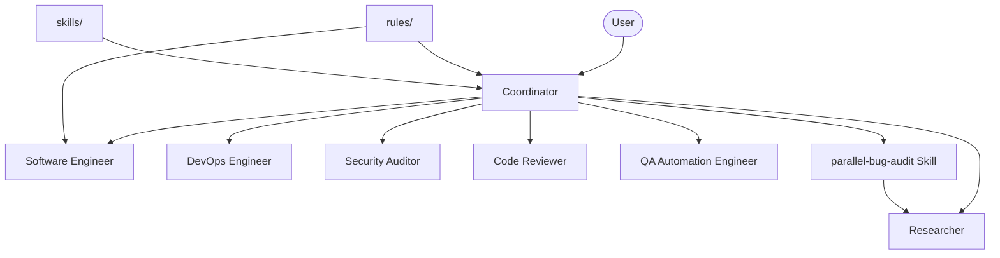

# OpenCode Agent Suite

Reusable **agents**, **rules**, and **skills** for [OpenCode](https://opencode.ai) — orchestrated through the **Coordinator** as the central interface for research, planning, audit, and execution.

```bash
bash install.sh          # install
bash uninstall.sh        # remove everything
```

Restart OpenCode → use `@Coordinator`.

## Architecture



**Core principle:** Always start with `@Coordinator`. It investigates, plans, delegates, and verifies — do not talk directly to implementation subagents except for targeted read-only research.

| Component              | Role                                                  |
| ---------------------- | ----------------------------------------------------- |
| **Coordinator**        | Primary agent — central interface for everything      |
| **Researcher**         | Read-only subagent for codebase research              |
| **parallel-bug-audit** | Skill for parallel bug/gap audits via Researcher      |
| **Rules**              | Project-wide coding conventions                       |
| **Other subagents**    | Software Engineer, Code Reviewer, Security Auditor, … |

---

## Installation

One command — copies **all agents, rules, and skills** from this repo into OpenCode.

### Global (recommended — applies to all projects)

```bash
bash install.sh
```

Installs to `~/.config/opencode/`:

- `agents/` — all agent definitions
- `rules/` — coding conventions
- `skills/` — all skills (e.g. `parallel-bug-audit`)
- `opencode.jsonc` + `AGENTS.md` — Coordinator as default

### Project-specific

```bash
bash install.sh /path/to/your-project
```

Installs to `.opencode/` in the target project and creates `opencode.json`.

### Update

Run again — overwrites existing files:

```bash
bash install.sh
```

**Uninstall** (clean reset before reinstall):

```bash
bash uninstall.sh
```

Then **restart OpenCode** and start with `@Coordinator`.

---

## Prerequisites

1. [OpenCode installed](https://opencode.ai/docs) (terminal, desktop, or IDE)
2. At least one LLM provider configured (`/connect` in the TUI)

---

## Setup in detail

### 1. Coordinator as default agent

The Coordinator is the **only entry point** for productive work. It handles:

- **Research** — delegates to `@Researcher` instead of filling context itself
- **Planning** — writes plans to `.opencode/state/current_plan.md`
- **Execution** — delegates tasks to Software Engineer, DevOps, …
- **Audit** — Security Auditor, Code Reviewer, bug-audit skill
- **Verification** — convergence loops on REJECTED reviews

In `opencode.json`:

```json
{
  "default_agent": "Coordinator",
  "agent": {
    "build": { "disable": true },
    "plan": { "disable": true }
  }
}
```

> Disable built-in `build` and `plan` agents so work does not accidentally bypass the orchestrator. Each agent defines its own model and `reasoningEffort` in its frontmatter — see the table below.

Restart OpenCode, then use **Tab** to confirm `Coordinator` is selected as the primary agent.

### 2. Researcher

The Researcher is a **read-only subagent** (`mode: subagent`). The Coordinator invokes it via the `task` tool, or you can call it manually with `@Researcher`.

**Installation:** lives in `agents/Researcher.md` → copied to `.opencode/agents/Researcher.md`.

**Important:**

- No write permissions — only `read`, `grep`, `glob`, `list`
- Every claim needs `path:line` citations
- Never guess — on empty results: `NO RESULTS FOUND IN CODEBASE`

**Typical flow:**

```
@Coordinator Investigate how auth works in this project
```

→ Coordinator delegates to Researcher, synthesizes the report, continues planning.

**Direct invocation** (isolated research without planning):

```
@Researcher Where is JWT validated? Show all entry points.
```

### 3. Rules

Rules define coding conventions. They live in `rules/` and are loaded via `opencode.json`:

```json
{
  "instructions": ["AGENTS.md", ".opencode/rules/*.md"]
}
```

Rules included in this repo:

| File                      | Content                                      |
| ------------------------- | -------------------------------------------- |
| `changelog-versioning.md` | Changelog, version bump, release hygiene     |
| `documentation.md`        | Project docs, inline docs, `docs/` structure |
| `code-quality.md`         | Lint, build, DRY, maintainability            |
| `programming-style.md`    | FP, typing, functions (general)              |
| `code-styles.md`          | Architecture invariants (project-specific)   |
| `error-handling.md`       | Raising errors, context, logging             |
| `tooling.md`              | Dependencies, project environments           |
| `workflow.md`             | Git, branches, issues, repo inspection       |
| `react-guidelines.md`     | React-specific conventions                   |
| `testing.md`              | Testing philosophy + project-specific rules  |

**Also recommended:** generate project-root `AGENTS.md` via `/init`. OpenCode merges `AGENTS.md` with `instructions` from `opencode.json`.

The Coordinator and Software Engineer reference rules automatically in delegation prompts (`.opencode/rules/`, `AGENTS.md`, `docs/_invariants/`).

### 4. Bug-audit skill (`parallel-bug-audit`)

Parallel bug/gap audit: Coordinator maps a subsystem, builds a failure-mode brief, dispatches multiple `@Researcher` instances in parallel, and consolidates findings.

**Installation:** automatic via `bash install.sh` (lives in `skills/parallel-bug-audit/`).

**Permissions in `opencode.json`:**

```json
{
  "permission": {
    "skill": {
      "parallel-bug-audit": "allow"
    },
    "task": "allow"
  }
}
```

**Invocation** (always via Coordinator):

```
@Coordinator Audit the email sync subsystem for bugs and gaps
```

The Coordinator loads the skill, dispatches parallel Researchers, and returns a classified report (Confirmed Bug / Gap / Suspected / Misleading).

**Cache directory** (gitignored in target projects):

```
.opencode/.cache/bug-audit/<target>-failure-modes.md
```

---

## Configuration

Set automatically by `install.sh`. Per-agent models and reasoning are defined in each agent's frontmatter (`agents/*.md`). Templates live in `templates/`:

| File                              | Usage                                        |
| --------------------------------- | -------------------------------------------- |
| `templates/opencode.global.jsonc` | Global → `~/.config/opencode/opencode.jsonc` |
| `templates/opencode.project.json` | Project → `opencode.json`                    |
| `templates/AGENTS.md`             | Global/project rules                         |

---

## Directory structure (target project after setup)

```
your-project/
├── AGENTS.md                          # Project-specific rules (/init)
├── opencode.json                      # OpenCode configuration
├── .opencode/
│   ├── agents/
│   │   ├── Coordinator.md             # Primary — always start here
│   │   ├── Researcher.md              # Read-only research
│   │   ├── Software Engineer.md
│   │   ├── Code Reviewer.md
│   │   ├── Security Auditor.md
│   │   └── …
│   ├── rules/
│   │   ├── code-styles.md
│   │   ├── react-guidelines.md
│   │   └── testing.md
│   ├── skills/
│   │   └── parallel-bug-audit/
│   │       ├── SKILL.md
│   │       └── references/
│   └── state/
│       └── current_plan.md            # Active plan (runtime)
└── docs/
    └── _invariants/                   # Optional: project-specific invariants
```

---

## Workflow examples

### Implement a feature

```
@Coordinator Implement user notifications with WebSocket push
```

1. Coordinator categorizes (FEATURE), investigates, writes plan
2. User approves plan
3. Coordinator delegates task 1 to Software Engineer
4. Security Auditor + Code Reviewer review
5. Next task — until completion report

### Fix a bug

```
@Coordinator Login fails after token refresh — find root cause and fix
```

Coordinator runs the bug root-cause gate, plans a fix at the source (not the symptom).

### Audit a subsystem

```
@Coordinator Audit src/sync/ for real bugs and gaps before we refactor
```

Coordinator loads `parallel-bug-audit`, dispatches 4–7 parallel Researchers, returns deduplicated report.

### Quick research (no plan)

```
@Coordinator Where is rate limiting configured? Research only, no code.
```

Coordinator delegates to Researcher, returns structured report — skips Phase 3 execution loop.

---

## Included agents

| Agent                      | Mode       | Model           | Reasoning | Temp | Description                                     |
| -------------------------- | ---------- | --------------- | --------- | ---- | ----------------------------------------------- |
| **Coordinator**            | `primary`  | `gpt-5.6-terra` | `high`    | 0.2  | Orchestrates the full SDLC — **only Tab agent** |
| **Researcher**             | `subagent` | `gpt-5.6-luna`  | `medium`  | 0.2  | Read-only codebase research (`@Researcher`)     |
| **Software Engineer**      | `subagent` | `gpt-5.6-sol`   | `high`    | 0.1  | Implementation                                  |
| **Code Reviewer**          | `subagent` | `gpt-5.6-terra` | `medium`  | 0.5  | Code review                                     |
| **Security Auditor**       | `subagent` | `gpt-5.6-sol`   | `high`    | 0.5  | Security audit                                  |
| **DevOps Engineer**        | `subagent` | `gpt-5.6-luna`  | `low`     | 0.2  | Infrastructure & CI/CD                          |
| **QA Automation Engineer** | `subagent` | `gpt-5.6-terra` | `medium`  | —    | Test automation                                 |
| **Technical Writer**       | `subagent` | `gpt-5.6-terra` | `medium`  | 0.2  | Documentation                                   |
| **Doc Reviewer**           | `subagent` | `gpt-5.6-luna`  | `medium`  | 0.2  | Documentation review                            |
| **PRD Critic**             | `subagent` | `gpt-5.6-terra` | `high`    | 0.2  | PRD analysis                                    |

> **Tier guide:** **Luna** — fast, cheap (Research, Doc Review, DevOps). **Terra** — everyday workhorse (Coordinator, Review, QA, Docs). **Sol** — only where code/security depth matters (Engineer, Security Auditor). Reasoning stays at `low` / `medium` / `high` — no `max` or `xhigh`.

---

## Troubleshooting

| Problem                             | Solution                                                                                                                                      |
| ----------------------------------- | --------------------------------------------------------------------------------------------------------------------------------------------- |
| Only Coordinator visible in Tab bar | **Normal.** Tab shows only `primary` agents. Subagents via `@Software Engineer`, `@Researcher`, etc. — or Coordinator delegates automatically |
| Which agents are installed?         | `opencode agent list` in the terminal                                                                                                         |
| Coordinator not in agent list       | Restart OpenCode; run `bash install.sh` again                                                                                                 |
| Skill not visible                   | Folder must be named `parallel-bug-audit`; `SKILL.md` in CAPS; restart OpenCode                                                               |
| Researcher cannot be dispatched     | Set `task: allow` in Coordinator permissions                                                                                                  |
| Rules ignored                       | Check `instructions` in `opencode.json`; paths relative to project root                                                                       |
| Wrong model                         | Edit `model:` / `reasoningEffort:` in the agent's frontmatter under `agents/`, then re-run `bash install.sh`                                 |
| Built-in `build` starts instead     | Set `default_agent: "Coordinator"`; disable `build`/`plan`                                                                                    |

---

## Repo structure

```
opencode-agent/
├── install.sh                 # One-command install
├── uninstall.sh               # Remove everything
├── changelog.md
├── README.md
├── agents/                    # All agent definitions
├── rules/                     # Coding conventions
├── skills/
│   └── parallel-bug-audit/    # Bug-audit skill
└── templates/                 # opencode.json + AGENTS.md templates
```

---

## Origin

The original agent and rules scaffold for [OpenCode](https://opencode.ai) comes from [Tom Kühl](https://github.com/tomkuehl). This repository adapts and extends it and adds `install.sh` / `uninstall.sh`. Further changes are documented in [`changelog.md`](changelog.md).

---

## Further reading

- [OpenCode Agents](https://opencode.ai/docs/agents/)
- [OpenCode Rules](https://opencode.ai/docs/rules/)
- [OpenCode Skills](https://opencode.ai/docs/skills/)
- [Changelog](changelog.md)
