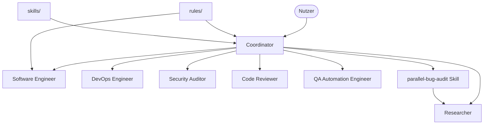

# OpenCode Agent Suite

Wiederverwendbare **Agents**, **Rules** und **Skills** für [OpenCode](https://opencode.ai) — orchestriert über den **Coordinator** als zentrale Schnittstelle für Research, Planung, Audit und Ausführung.

```bash
bash install.sh          # installieren
bash uninstall.sh        # alles wieder entfernen
```

OpenCode neu starten → `@Coordinator` nutzen.

## Architektur



**Grundprinzip:** Starte **immer** mit `@Coordinator`. Er untersucht, plant, delegiert und verifiziert — du sprichst nicht direkt mit Implementierungs-Subagents, außer für gezielte Read-only-Research.

| Komponente             | Rolle                                                 |
| ---------------------- | ----------------------------------------------------- |
| **Coordinator**        | Primary Agent — zentrale Schnittstelle für alles      |
| **Researcher**         | Read-only Subagent für Codebase-Recherche             |
| **parallel-bug-audit** | Skill für parallele Bug-/Gap-Audits via Researcher    |
| **Rules**              | Projektweite Coding-Konventionen                      |
| **Weitere Subagents**  | Software Engineer, Code Reviewer, Security Auditor, … |

---

## Installation

Ein Befehl — kopiert **alle Agents, Rules und Skills** aus diesem Repo nach OpenCode.

### Global (empfohlen — gilt in allen Projekten)

```bash
bash install.sh
```

Installiert nach `~/.config/opencode/`:

- `agents/` — alle Agent-Definitionen
- `rules/` — Coding-Konventionen
- `skills/` — alle Skills (z. B. `parallel-bug-audit`)
- `opencode.jsonc` + `AGENTS.md` — Coordinator als Default

### Projektspezifisch

```bash
bash install.sh /pfad/zu/deinem-projekt
```

Installiert nach `.opencode/` im Zielprojekt + legt `opencode.json` an.

### Update

Einfach nochmal ausführen — überschreibt die bestehenden Dateien:

```bash
bash install.sh
```

**Deinstallieren** (sauberer Reset vor Neuinstallation):

```bash
bash uninstall.sh
```

Danach **OpenCode neu starten** und mit `@Coordinator` loslegen.

---

## Voraussetzungen

1. [OpenCode installiert](https://opencode.ai/docs) (Terminal, Desktop oder IDE)
2. Mindestens ein LLM-Provider konfiguriert (`/connect` in der TUI)

---

## Einrichtung im Detail

### 1. Coordinator als Default-Agent

Der Coordinator ist der **einzige Einstiegspunkt** für produktive Arbeit. Er übernimmt:

- **Research** — delegiert an `@Researcher` statt selbst den Context zu füllen
- **Planung** — schreibt Pläne nach `.opencode/state/current_plan.md`
- **Ausführung** — delegiert Tasks an Software Engineer, DevOps, …
- **Audit** — Security Auditor, Code Reviewer, Bug-Audit-Skill
- **Verifikation** — Convergence-Loops bei REJECTED Reviews

In `opencode.json`:

```json
{
  "default_agent": "Coordinator",
  "agent": {
    "build": { "disable": true },
    "plan": { "disable": true }
  }
}
```

> Built-in Agents `build` und `plan` deaktivieren, damit nicht versehentlich ohne Orchestrator gearbeitet wird. Passe Modelle in den Agent-Frontmatter-Blöcken an deine Provider an (`model: openai/gpt-5.5` → dein verfügbares Modell).

OpenCode neu starten, dann mit **Tab** prüfen, ob `Coordinator` als Primary Agent ausgewählt ist.

### 2. Researcher

Der Researcher ist ein **read-only Subagent** (`mode: all`). Er wird vom Coordinator per `task`-Tool oder manuell via `@Researcher` aufgerufen.

**Installation:** Liegt in `agents/Researcher.md` → wird nach `.opencode/agents/Researcher.md` kopiert.

**Wichtig:**

- Keine Schreibrechte — nur `read`, `grep`, `glob`, `list`
- Jede Aussage braucht `path:line`-Zitate
- Nie raten — bei fehlenden Ergebnissen: `NO RESULTS FOUND IN CODEBASE`

**Typischer Flow:**

```
@Coordinator Untersuche, wie Auth in diesem Projekt funktioniert
```

→ Coordinator delegiert an Researcher, synthetisiert den Report, plant weiter.

**Direktaufruf** (nur für isolierte Recherche ohne Planung):

```
@Researcher Wo wird JWT validiert? Zeige alle Entry Points.
```

### 3. Rules

Rules definieren Coding-Konventionen. Sie liegen in `rules/` und werden über `opencode.json` eingebunden:

```json
{
  "instructions": ["AGENTS.md", ".opencode/rules/*.md"]
}
```

Enthaltene Rules in diesem Repo:

| Datei                     | Inhalt                                       |
| ------------------------- | -------------------------------------------- |
| `changelog-versioning.md` | Changelog, Version-Bump, Release-Hygiene     |
| `documentation.md`        | Projekt-Docs, Inline-Docs, `docs/`-Struktur  |
| `code-quality.md`         | Lint, Build, DRY, Maintainability            |
| `programming-style.md`    | FP, Typing, Funktionen (allgemein)           |
| `code-styles.md`          | Architektur-Invarianten (projektspezifisch)  |
| `error-handling.md`       | Fehler werfen, Kontext, Logging              |
| `tooling.md`              | Dependencies, Projekt-Environments           |
| `workflow.md`             | Git, Branches, Issues, Repo-Inspektion       |
| `react-guidelines.md`     | React-spezifische Konventionen               |
| `testing.md`              | Test-Philosophie + projektspezifische Regeln |

**Zusätzlich empfohlen:** Projekt-Root `AGENTS.md` via `/init` generieren lassen. OpenCode merged `AGENTS.md` + `instructions` aus `opencode.json`.

Der Coordinator und Software Engineer referenzieren Rules automatisch in Delegations-Prompts (`.opencode/rules/`, `AGENTS.md`, `docs/_invariants/`).

### 4. Bug-Audit-Skill (`parallel-bug-audit`)

Paralleler Bug-/Gap-Audit: Coordinator mappt ein Subsystem, erstellt ein Failure-Mode-Brief, dispatcht mehrere `@Researcher`-Instanzen parallel und konsolidiert die Findings.

**Installation:** automatisch via `bash install.sh` (liegt in `skills/parallel-bug-audit/`).

**Permissions in `opencode.json`:**

```json
{
  "permission": {
    "skill": {
      "parallel-bug-audit": "allow"
    },
    "task": "allow"
  }
}
```

**Aufruf** (immer über Coordinator):

```
@Coordinator Audit das Email-Sync-Subsystem auf Bugs und Gaps
```

Der Coordinator lädt den Skill, dispatcht parallel Researcher und liefert einen klassifizierten Report (Confirmed Bug / Gap / Suspected / Misleading).

**Cache-Verzeichnis** (gitignored in Zielprojekten):

```
.opencode/.cache/bug-audit/<target>-failure-modes.md
```

---

## Konfiguration

Wird automatisch von `install.sh` gesetzt. Templates liegen in `templates/`:

| Datei                             | Verwendung                                   |
| --------------------------------- | -------------------------------------------- |
| `templates/opencode.global.jsonc` | Global → `~/.config/opencode/opencode.jsonc` |
| `templates/opencode.project.json` | Projekt → `opencode.json`                    |
| `templates/AGENTS.md`             | Globale/Projekt-Regeln                       |

---

## Verzeichnisstruktur (Zielprojekt nach Setup)

```
dein-projekt/
├── AGENTS.md                          # Projekt-spezifische Regeln (/init)
├── opencode.json                      # OpenCode-Konfiguration
├── .opencode/
│   ├── agents/
│   │   ├── Coordinator.md             # Primary — immer starten
│   │   ├── Researcher.md              # Read-only Research
│   │   ├── Software Engineer.md
│   │   ├── Code Reviewer.md
│   │   ├── Security Auditor.md
│   │   └── …
│   ├── rules/
│   │   ├── code-styles.md
│   │   ├── react-guidelines.md
│   │   └── testing.md
│   ├── skills/
│   │   └── parallel-bug-audit/
│   │       ├── SKILL.md
│   │       └── references/
│   └── state/
│       └── current_plan.md            # Laufender Plan (runtime)
└── docs/
    └── _invariants/                   # Optional: projekt-spezifische Invarianten
```

---

## Workflow-Beispiele

### Feature implementieren

```
@Coordinator Implementiere User-Notifications mit WebSocket-Push
```

1. Coordinator kategorisiert (FEATURE), investigiert, schreibt Plan
2. User approved Plan
3. Coordinator delegiert Task 1 an Software Engineer
4. Security Auditor + Code Reviewer prüfen
5. Nächster Task — bis Completion Report

### Bug fixen

```
@Coordinator Der Login schlägt nach Token-Refresh fehl — finde Root Cause und fixe
```

Coordinator führt Bug Root Cause Gate durch, plant Fix am Symptom-Ursprung (nicht am Symptom).

### Subsystem auditieren

```
@Coordinator Audit src/sync/ auf echte Bugs und Gaps bevor wir refactoren
```

Coordinator lädt `parallel-bug-audit`, dispatcht 4–7 parallele Researcher, liefert deduplizierten Report.

### Schnelle Recherche (ohne Plan)

```
@Coordinator Wo wird Rate-Limiting konfiguriert? Nur Recherche, kein Code.
```

Coordinator delegiert an Researcher, gibt strukturierten Report zurück — ohne Phase 3 Execution Loop.

---

## Enthaltene Agents

| Agent                      | Mode       | Beschreibung                                            |
| -------------------------- | ---------- | ------------------------------------------------------- |
| **Coordinator**            | `primary`  | Orchestriert den gesamten SDLC — **einziger Tab-Agent** |
| **Researcher**             | `subagent` | Read-only Codebase-Recherche (`@Researcher`)            |
| **Software Engineer**      | `subagent` | Implementierung                                         |
| **Code Reviewer**          | `subagent` | Code-Review                                             |
| **Security Auditor**       | `subagent` | Sicherheits-Audit                                       |
| **DevOps Engineer**        | `subagent` | Infrastruktur & CI/CD                                   |
| **QA Automation Engineer** | `subagent` | Test-Automatisierung                                    |
| **Technical Writer**       | `subagent` | Dokumentation                                           |
| **Doc Reviewer**           | `subagent` | Dokumentations-Review                                   |
| **PRD Critic**             | `subagent` | PRD-Analyse                                             |

---

## Troubleshooting

| Problem                                    | Lösung                                                                                                                                      |
| ------------------------------------------ | ------------------------------------------------------------------------------------------------------------------------------------------- |
| Nur Coordinator in der Tab-Leiste sichtbar | **Normal.** Tab zeigt nur `primary`-Agents. Subagents via `@Software Engineer`, `@Researcher` etc. — oder Coordinator delegiert automatisch |
| Welche Agents sind installiert?            | `opencode agent list` im Terminal                                                                                                           |
| Coordinator nicht in Agent-Liste           | OpenCode neu starten; `bash install.sh` erneut ausführen                                                                                    |
| Skill nicht sichtbar                       | Ordner muss `parallel-bug-audit` heißen; `SKILL.md` in CAPS; OpenCode neu starten                                                           |
| Researcher kann nicht dispatched werden    | `task: allow` in Coordinator-Permissions setzen                                                                                             |
| Rules werden ignoriert                     | `instructions` in `opencode.json` prüfen; Pfade relativ zum Projekt-Root                                                                    |
| Falsches Modell                            | `model:` in Agent-Frontmatter an verfügbare Provider anpassen                                                                               |
| Built-in `build` startet statt Coordinator | `default_agent: "Coordinator"` setzen; `build`/`plan` disable                                                                               |

---

## Repo-Struktur

```
opencode-agent/
├── install.sh                 # Ein-Befehl-Installation
├── uninstall.sh               # Alles wieder entfernen
├── README.md
├── agents/                    # Alle Agent-Definitionen
├── rules/                     # Coding-Konventionen
├── skills/
│   └── parallel-bug-audit/    # Bug-Audit-Skill
└── templates/                 # opencode.json + AGENTS.md Vorlagen
```

---

## Weiterführend

- [OpenCode Agents](https://opencode.ai/docs/agents/)
- [OpenCode Rules](https://opencode.ai/docs/rules/)
- [OpenCode Skills](https://opencode.ai/docs/skills/)
